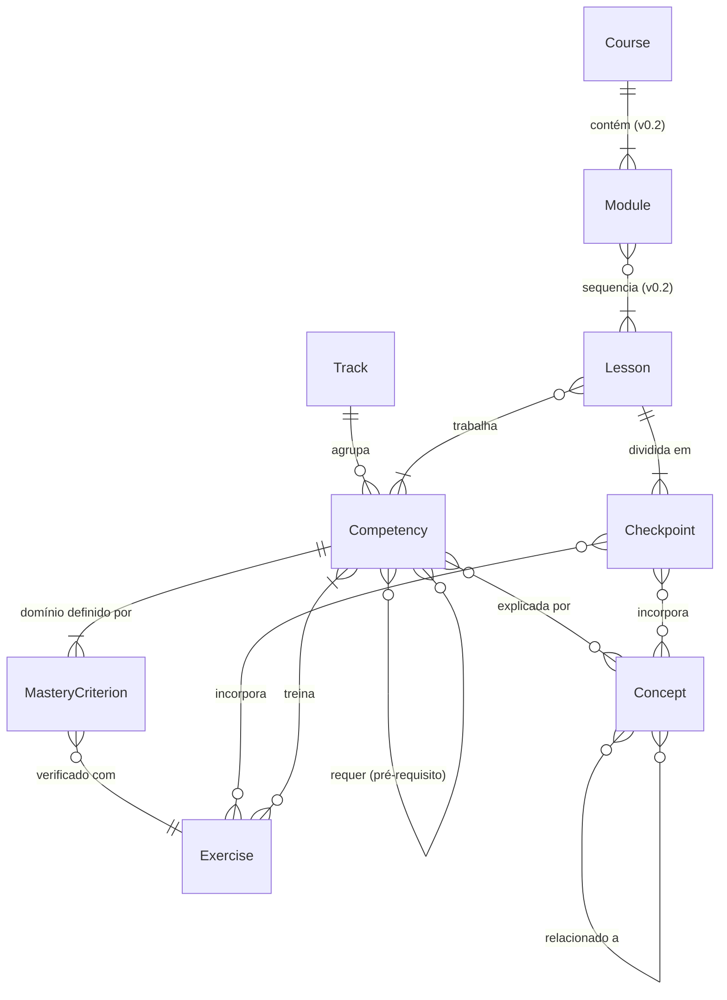
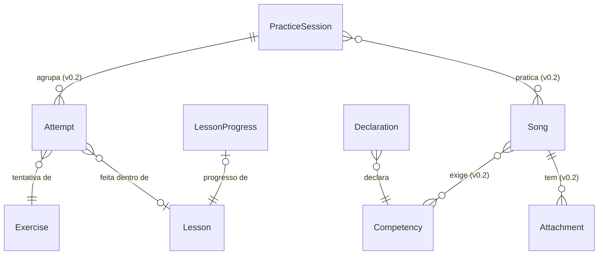

# KeyPath — Modelo de dados

> Versão 0.2 · 14/11/2026 · Status: **em revisão**
>
> Convenção: **estrutura em inglês** (nomes de entidades, campos e chaves dos arquivos) e **conteúdo em português** (textos e identificadores/slugs). Ver [D19](decisoes.md).

## 1. Visão geral

O modelo tem três camadas, com dependências em uma única direção:

```
Conteúdo (Git, somente leitura)  ◄──referencia──  Dados do usuário (IndexedDB)
                │                                          │
                └──────────────┬───────────────────────────┘
                               ▼
               Estado derivado (calculado, nunca salvo)
```

- **Conteúdo:** o que se ensina. Fica em arquivos no repositório, é validado no build e não muda em tempo de execução.
- **Dados do usuário:** apenas **fatos** (o que aconteceu): tentativas, declarações e checkpoints concluídos. Ficam no navegador e entram no backup.
- **Estado derivado:** domínio, nível, status de aula e recomendação. É recalculado pelas regras do domínio a partir das outras duas camadas, e **nada disso é persistido**.

Regras de referência:

- Os dados do usuário apontam para o conteúdo por `id`.
- O conteúdo **nunca** aponta para dados do usuário.
- Por isso, os `id` de conteúdo são **estáveis**: depois de publicado, um `id` não é renomeado.

## 2. Glossário

| Termo | Entidade | Camada | No MVP |
|---|---|---|---|
| Trilha | `Track` | Conteúdo (config) | ✅ |
| Nível | `Level` | Conteúdo (config) | ✅ |
| Estilo | `Style` | Conteúdo (config) | ✅ |
| Competência | `Competency` | Conteúdo | ✅ |
| Critério de domínio | `MasteryCriterion` | Conteúdo (dentro de `Competency`) | ✅ |
| Conceito (verbete) | `Concept` | Conteúdo | ✅ |
| Aula | `Lesson` | Conteúdo | ✅ |
| Ponto de verificação | `Checkpoint` | Conteúdo (dentro de `Lesson`) | ✅ |
| Exercício | `Exercise` | Conteúdo | ✅ |
| Curso | `Course` | Conteúdo | ⏳ v0.2 |
| Módulo | `Module` | Conteúdo (dentro de `Course`) | ⏳ v0.2 |
| Tentativa | `Attempt` | Usuário | ✅ |
| Declaração | `Declaration` | Usuário | ✅ |
| Progresso de aula | `LessonProgress` | Usuário | ✅ |
| Configurações | `Settings` | Usuário | ✅ |
| Música | `Song` | Usuário | ⏳ v0.2 |
| Anexo | `Attachment` | Usuário | ⏳ v0.2 |
| Sessão de prática | `PracticeSession` | Usuário | ⏳ v0.2 |

## 3. Diagramas de relações

### 3.1 Conteúdo



`Style` é uma etiqueta (`styles: string[]`) presente em `Competency`, `Concept`, `Lesson`, `Exercise`, `Course` e `Song`. Ela não aparece no diagrama para não poluí-lo. `Level` é um número de 1 a 5 em `Competency`.

### 3.2 Dados do usuário



## 4. Entidades de conteúdo

### 4.1 `Track`, `Level`, `Style` (configuração)

São listas fixas em `content/config/`. Não há tela para editá-las.

| Entidade | Campos |
|---|---|
| `Track` | `id` (`harmonia`), `name`, `description`, `kind` (`discipline` \| `application`), `order` |
| `Level` | `number` (1–5), `name` |
| `Style` | `id` (`gospel`), `name` |

### 4.2 `Competency`

| Campo | Tipo | Descrição |
|---|---|---|
| `id` | slug | `<trilha>.<nome>`. Exemplo: `harmonia.campo-harmonico-maior-triades` |
| `track` | `Track.id` | Exatamente uma trilha |
| `level` | 1–5 | Dificuldade |
| `title`, `description` | texto | Descrição observável ("forma, toca e nomeia…") |
| `core` | boolean (padrão `true`) | Se entra no cálculo de nível |
| `prerequisites` | `Competency.id[]` | Pode apontar para outras trilhas |
| `concepts` | `Concept.id[]` | Verbetes da Biblioteca |
| `styles` | `Style.id[]` | Etiquetas |
| `mastery` | `MasteryCriterion[]` (≥ 1) | **Todos** precisam ser cumpridos (E lógico) |

A competência é dona dos critérios de domínio porque o domínio pode ser demonstrado sem passar por aula nenhuma.

### 4.3 `MasteryCriterion`

| Campo | Tipo | Descrição |
|---|---|---|
| `id` | slug local | Único dentro da competência |
| `method` | `quiz` \| `self-assessment` \| `performance`⏳ \| `review`⏳ | Como o critério é verificado |
| `exercise` | `Exercise.id` | O exercício usado como evidência |
| `minScore` | 0–1 (padrão 0.8) | Apenas para `quiz` |
| `distinctDays` | inteiro (padrão 1) | Quantos dias diferentes o critério precisa ser cumprido |

O **tipo do exercício** (o que se faz) é diferente do **método do critério** (como se verifica). Um exercício de execução é verificado por `self-assessment` no MVP. Quando houver MIDI, o mesmo exercício pode ser verificado por `performance`, sem mudar o restante do modelo.

### 4.4 `Concept`

| Campo | Tipo | Descrição |
|---|---|---|
| `id` | slug | Exemplo: `emprestimo-modal` |
| `title` | texto | |
| `aliases` | texto[] | Sinônimos para a busca ("mistura modal", "modal interchange") |
| `summary` | texto | Uma ou duas frases, usadas nos resultados de busca e nas prévias |
| `tracks` | `Track.id[]` | Pode pertencer a várias trilhas (só serve para filtro) |
| `styles` | `Style.id[]` | |
| `related` | `Concept.id[]` | |
| `body` | Markdown | Texto do verbete, com blocos musicais |

### 4.5 `Lesson` e `Checkpoint`

| Campo | Tipo | Descrição |
|---|---|---|
| `id` | slug | `harmonia.emprestimo-modal-subdominante-menor` |
| `title`, `summary` | texto | |
| `track` | `Track.id` | Trilha principal, usada para exibição |
| `competencies` | `Competency.id[]` (≥ 1) | Competências trabalhadas |
| `styles` | `Style.id[]` | |
| `estimatedMinutes` | inteiro | Opcional |
| `body` | Markdown | Introdução e checkpoints |

Os **checkpoints** são declarados no corpo da aula (ver §7.3). Cada um tem `id` (único na aula) e `title`, e pode conter conceitos incorporados, exemplos musicais, exercícios e blocos de erros comuns.

Campos **derivados** (não são escritos à mão):

- `level` da aula: o maior nível entre as competências trabalhadas.
- Objetivos: os títulos das competências trabalhadas.
- Pré-requisitos: a união dos pré-requisitos das competências trabalhadas, menos as próprias competências trabalhadas.
- Critérios de domínio: os critérios das competências trabalhadas.

### 4.6 `Exercise`

| Campo | Tipo | Descrição |
|---|---|---|
| `id` | slug | `harmonia.campo-maior.quiz` |
| `title`, `prompt` | texto / Markdown | |
| `type` | `quiz` \| `performance` | |
| `competencies` | `Competency.id[]` (≥ 1) | Competências que o exercício treina |
| `styles` | `Style.id[]` | |
| `questions` | `Question[]` | Apenas `quiz` |
| `parameters` | `{ keys?: string[], targetBpm?: number, hands?: 'left' \| 'right' \| 'both' }` | Apenas `performance` |
| `checklist` | `{ id, text }[]` | Apenas `performance`. São os itens de autoavaliação |
| `example` | bloco musical | Opcional. Referência tocável |

`Question`:

- `id` e `prompt`;
- `kind`: `single-choice` ou `multiple-choice`;
- `options`, que podem conter blocos musicais, como "toque para ouvir";
- `correct`: índices das opções corretas;
- `explanation`.

### 4.7 `Course` e `Module` *(v0.2)*

- `Course`: `id`, `title`, `description`, `styles`, `modules: Module[]`.
- `Module`: `id`, `title`, `items: ({ lesson } | { exercise })[]`.

Nenhum dos dois tem estado próprio: o progresso de um curso é derivado das aulas e competências que ele contém.

## 5. Dados do usuário

São armazenados no IndexedDB. Todo registro tem `id` (UUID) e datas no formato ISO 8601.

### 5.1 `Attempt` — tentativa de exercício

| Campo | Tipo | Descrição |
|---|---|---|
| `exerciseId` | `Exercise.id` | |
| `startedAt`, `finishedAt` | data | |
| `context` | `{ lessonId?, checkpointId?, sessionId?⏳ }` | De onde a tentativa foi feita |
| `result` | `QuizResult` \| `SelfAssessmentResult` | |

- `QuizResult`: `{ answers: Record<questionId, number[]>, score: 0–1 }`
- `SelfAssessmentResult`: `{ checked: Record<itemId, boolean>, keysPlayed?: string[], bpm?: number, note?: string }`
- (futuro) `PerformanceResult`: os eventos MIDI capturados e a avaliação automática.

### 5.2 `Declaration` — conhecimento prévio

`{ competencyId, declaredAt, note? }`. Existe no máximo uma declaração por competência. Para desfazer, o registro é removido.

### 5.3 `LessonProgress`

`{ lessonId, startedAt, lastVisitedAt, checkpoints: { [checkpointId]: completedAt } }`. Existe um registro por aula. Um checkpoint é concluído manualmente pelo aluno, com o botão "concluí esta parte".

### 5.4 `Settings`

`{ noteNaming: 'latin' | 'letters' | 'both', chordSymbols: 'br', soundEnabled, volume }`. É um registro único.

### 5.5 `Song`, `Attachment`, `PracticeSession` *(v0.2)*

- `Song`:
  - `title`, `artist?`, `key?`, `bpm?`;
  - `styles`, `competencies` (as que a música exige);
  - `status`: `wishlist` \| `learning` \| `ready` \| `repertoire`;
  - `notes` (Markdown).
- `Attachment`:
  - `songId`, `kind` (`pdf` \| `image` \| `midi` \| `youtube`), `name`;
  - `blobId?` (arquivo guardado no IndexedDB) ou `url?` (YouTube, com tempo inicial opcional).
- `PracticeSession`: `startedAt`, `endedAt`, `focus?`, `songs: { songId, minutes, note? }[]`, `notes`. As tentativas apontam para a sessão por meio de `Attempt.context.sessionId`.

## 6. Estado derivado (regras de domínio)

São funções puras do tipo `(catálogo, fatos do usuário, data atual) → estado`. Ficam em `src/domain/progress` e são cobertas por testes unitários.

| Regra | Definição |
|---|---|
| **Critério cumprido** | `quiz`: o número de dias distintos com uma tentativa do exercício com `score ≥ minScore` é ≥ `distinctDays`. `self-assessment`: o número de dias distintos com uma tentativa em que **todos** os itens do checklist foram marcados é ≥ `distinctDays`. |
| **Competência dominada** | Todos os critérios estão cumpridos. `masteredAt` é a data em que o último deles foi cumprido. |
| **Status da competência** | `mastered` › `declared` › `in-progress` (há tentativa de um exercício da competência ou checkpoint concluído em aula que a trabalha) › `not-started` |
| **Competência satisfeita** | `mastered` ou `declared` |
| **Pré-requisitos atendidos** | Todos os pré-requisitos diretos estão satisfeitos. Apenas informa, não bloqueia. |
| **Competência pronta** | Pré-requisitos atendidos e a competência ainda não está satisfeita |
| **Nível da trilha** | O maior N em que todas as competências `core` da trilha, dos níveis 1 a N, estão satisfeitas. Um nível sem competências interrompe a contagem. O resultado 0 significa "sem nível". |
| **Status da aula** | `completed` (todos os checkpoints concluídos), `in-progress` (algum concluído) ou `not-started` |
| **Recomendação** | Ver [produto §5](produto.md#5-recomendação-mvp) |

Esta separação existe por três motivos:

- mudar uma regra (por exemplo, o `minScore` padrão) não exige migrar dados;
- a revisão espaçada e o MIDI, no futuro, entram como **novos fatos e novas regras**, sem reescrever o que já existe;
- o backup só precisa conter fatos.

## 7. Formato dos arquivos de conteúdo

### 7.1 Competências — `content/competencias/<trilha>.yaml`

```yaml
- id: harmonia.campo-harmonico-maior-triades
  track: harmonia
  level: 2
  title: Campo harmônico maior (tríades)
  description: Forma, toca e nomeia por grau as sete tríades do campo harmônico maior em qualquer tonalidade.
  prerequisites: [harmonia.triades, teoria.escala-maior]
  concepts: [campo-harmonico, graus-e-analise]
  mastery:
    - id: teoria
      method: quiz
      exercise: harmonia.campo-maior.quiz
      minScore: 0.8
    - id: execucao
      method: self-assessment
      exercise: harmonia.campo-maior.12-tons
      distinctDays: 2
```

### 7.2 Exercícios — `content/exercicios/<trilha>/<id>.yaml`

```yaml
id: harmonia.campo-maior.12-tons
title: Campo harmônico maior nas 12 tonalidades
type: performance
competencies: [harmonia.campo-harmonico-maior-triades]
prompt: Toque as sete tríades do campo, subindo, dizendo o grau de cada uma em voz alta.
parameters:
  keys: [C, G, D, A, E, B, F#, Db, Ab, Eb, Bb, F]
  targetBpm: 60
checklist:
  - id: tonalidades
    text: Toquei nas 12 tonalidades sem parar mais de dois tempos para pensar.
  - id: graus
    text: Nomeei corretamente o grau de cada acorde.
```

### 7.3 Aulas e conceitos — Markdown com *directives*

O texto é Markdown comum. As partes interativas são *directives* (sintaxe `:::`), o que mantém o conteúdo como texto puro, sem código.

```markdown
---
id: harmonia.emprestimo-modal-subdominante-menor
title: Empréstimo modal I — a subdominante menor
track: harmonia
competencies: [harmonia.emprestimo-modal-conceito, harmonia.subdominante-menor]
styles: [gospel]
estimatedMinutes: 120
---

Introdução da aula…

::::checkpoint{id="conceito" title="O que é emprestar de um modo"}
::concept{id="emprestimo-modal"}

Texto específico desta aula…

::progression{key="G" degrees="I I7 IV iv I"}

:::common-mistake
Achar que o iv menor "muda de tom". A tônica continua sendo G.
:::
::::

::::checkpoint{id="pratica" title="No teclado"}
::exercise{id="harmonia.subdominante-menor.12-tons"}
::::
```

Blocos musicais do MVP:

| Bloco | Exemplo |
|---|---|
| Um acorde | `::chord{symbol="Cm7" inversion="1"}` |
| Lista de acordes | `::chords{symbols="G G7 C Cm G" key="G"}` |
| Progressão por graus | `::progression{key="G" degrees="I IV iv I"}` |
| Escala | `::scale{root="D" type="harmonic-minor"}` |

Todos são renderizados com teclado visual, nomes das notas conforme a configuração, graus (quando há `key`) e botão para tocar.

A **notação canônica** dentro dos arquivos usa letras com `#` e `b` (C, Eb, F#m7). Ela não é ambígua e é interpretada pelo motor de teoria. A conversão para "Dó (C)" e para a cifra brasileira acontece só na exibição.

## 8. Regras de integridade (validadas no build)

O build falha se alguma destas regras for violada:

1. Os `id` são únicos por tipo de entidade e seguem o formato de slug.
2. Toda referência existe: trilha, nível, estilo, pré-requisito, conceito, exercício, competência e os `id` usados nas *directives*.
3. O grafo de pré-requisitos é **acíclico**.
4. Toda competência tem pelo menos um critério.
5. Um critério `quiz` aponta para um exercício `quiz`, e um critério `self-assessment` aponta para um exercício `performance`.
6. Se um exercício é usado em um critério da competência C, então ele lista C em `competencies`.
7. Toda aula tem pelo menos um checkpoint, e os `id` de checkpoint são únicos dentro da aula.
8. Toda cifra, grau e escala dos blocos musicais é interpretável pelo motor de teoria.

Estas situações geram apenas **avisos**: um pré-requisito com nível maior que o da competência, uma competência `core` sem nenhuma aula, e um conceito que nenhuma competência ou aula referencia.

## 9. Formato do backup

```json
{
  "format": "keypath-backup",
  "schemaVersion": 1,
  "exportedAt": "2026-11-14T12:00:00Z",
  "data": { "attempts": [], "declarations": [], "lessonProgress": [], "settings": {} }
}
```

- **MVP:** um arquivo `.json`. A importação **substitui** todos os dados, depois de uma confirmação, e aplica as migrações a partir de `schemaVersion`.
- **v0.2:** quando houver anexos, o backup passa a ser um `.zip` com `backup.json` e uma pasta `files/`. O mesmo `schemaVersion` controla a migração.
