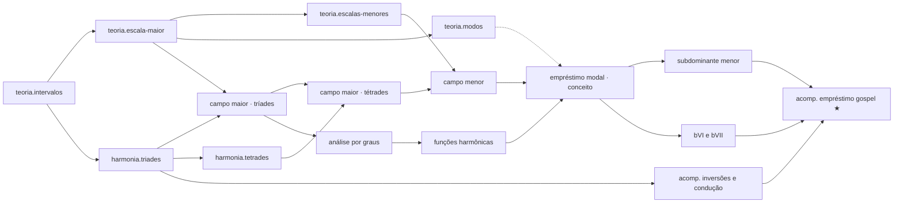

# KeyPath — Plano da fatia vertical de Harmonia

> Versão 0.1 · 14/11/2026 · Status: **rascunho para revisão musical**
>
> Objetivo: ir da revisão de campo harmônico até o empréstimo modal, com aplicações no gospel. Esta fatia serve para testar o modelo inteiro: Biblioteca, aulas, exercícios, critérios e progresso.

## 1. Competências

Também entram algumas competências de **Teoria** e de **Acompanhamento**. Elas servem de pré-requisitos e mostram como as trilhas se ligam. As de Teoria não terão aulas nesta fatia: o aluno declara ou demonstra essas competências pelos exercícios.

| id | Nível | Título |
|---|---|---|
| `teoria.intervalos` | 1 | Reconhece e forma intervalos de 2ª a 8ª |
| `teoria.escala-maior` | 1 | Constrói e toca a escala maior em todas as tonalidades |
| `teoria.escalas-menores` | 2 | Menor natural, harmônica e melódica |
| `teoria.modos` | 3 | Modos da escala maior e seus graus característicos |
| `harmonia.triades` | 1 | Forma tríades maiores, menores, diminutas e aumentadas sobre qualquer nota |
| `harmonia.campo-harmonico-maior-triades` | 2 | Campo harmônico maior com tríades, por grau, em qualquer tom |
| `harmonia.tetrades` | 2 | Forma 7M, 7, m7, m7(b5) e ° |
| `harmonia.campo-harmonico-maior-tetrades` | 2 | Campo harmônico maior com tétrades |
| `harmonia.analise-por-graus` | 2 | Converte cifra em graus e graus em cifra; transpõe |
| `harmonia.funcoes-harmonicas` | 2 | Classifica os graus em tônica, subdominante e dominante; faz substituições por função |
| `harmonia.campo-harmonico-menor` | 3 | Campo menor natural e harmônico (o V7 no menor) |
| `harmonia.emprestimo-modal-conceito` | 3 | Identifica o tom paralelo e reconhece acordes emprestados numa análise |
| `harmonia.subdominante-menor` | 3 | Usa iv, iiø e bVI como subdominante menor (IV → iv → I) |
| `harmonia.bvi-bvii` | 3 | Usa bVI e bVII emprestados e as cadências bVI → bVII → I |
| `acompanhamento.inversoes-e-conducao` | 2 | Encadeia acordes com inversões e o menor movimento de vozes |
| `acompanhamento.emprestimo-gospel` ★ | 3 | Aplica iv, bVI e bVII em progressões gospel típicas, com boa condução de vozes |

★ = etiqueta `gospel`, `core: false`. Fica fora do cálculo de nível porque é específica de um estilo.

A seta tracejada é uma decisão em aberto: `teoria.modos` é pré-requisito do empréstimo modal ou só enriquece o tema? Para empréstimos do menor paralelo, os modos não são necessários. Minha proposta é **não** tornar `teoria.modos` pré-requisito nesta fatia.

## 2. Aulas (7, profundas)

| # | Aula | Competências trabalhadas | Checkpoints previstos |
|---|---|---|---|
| 1 | Revisão: tríades e campo harmônico maior | triades, campo-maior-triades, analise-por-graus | tríades · o campo · graus e transposição · no teclado |
| 2 | Tétrades e o campo com sétimas | tetrades, campo-maior-tetrades | tipos de tétrade · o campo com sétimas · sonoridade gospel do 7M e do m7 |
| 3 | Funções harmônicas | funcoes-harmonicas | T, SD e D · substituições · ouvindo funções em músicas |
| 4 | Inversões e condução de vozes | acompanhamento.inversoes-e-conducao | inversões · menor movimento · aplicando no campo |
| 5 | O campo harmônico menor | campo-harmonico-menor | menor natural · o V7 da menor harmônica · comparação com o maior |
| 6 | Empréstimo modal I: a subdominante menor | emprestimo-modal-conceito, subdominante-menor | tom paralelo · o iv · iiø e bVI · cadências plagais menores |
| 7 | Empréstimo modal II: bVI, bVII e o gospel | bvi-bvii, acompanhamento.emprestimo-gospel | bVI e bVII · cadências · progressões gospel · aplicando em músicas |

Exemplos gospel previstos (em G):

- I → I7 → IV → iv → I (G G7 C Cm G);
- IV → iv → I com o iv em inversão;
- bVI → bVII → I (Eb F G) como final de música.

Os exemplos concretos de músicas serão definidos com você na escrita das aulas.

## 3. Conceitos da Biblioteca (~14)

Intervalo · Escala maior · Escalas menores · Modos gregos · Tríade · Tétrade · Inversão · Condução de vozes · Campo harmônico · Graus e análise · Funções harmônicas · Tom paralelo (homônimo) · Empréstimo modal · Subdominante menor · Cifragem (notação de acordes)

## 4. Exercícios

Em geral, cada competência tem **um quiz** (conhecimento) e **um exercício de execução** (teclado, com autoavaliação). Isso dá cerca de 30 exercícios. A regra padrão de domínio é:

- quiz com aproveitamento de pelo menos 80%;
- execução com todos os itens do checklist marcados em **2 dias diferentes**, o que é uma forma simples de checar retenção enquanto a revisão espaçada não existe.

## 5. Processo de escrita

1. Escrever primeiro as **competências e o grafo** (este documento, revisado por você).
2. Escrever os **conceitos**.
3. Escrever os **exercícios**.
4. Escrever as **aulas**, que incorporam os itens anteriores.

O build valida tudo a cada passo. Eu redijo e **você revisa o conteúdo musical** antes de cada etapa ser considerada concluída.
